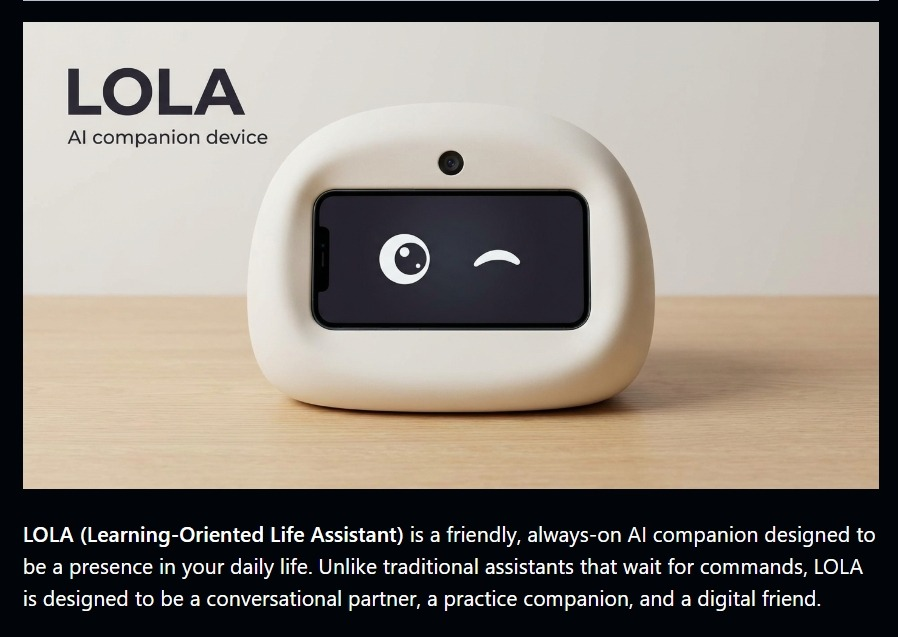
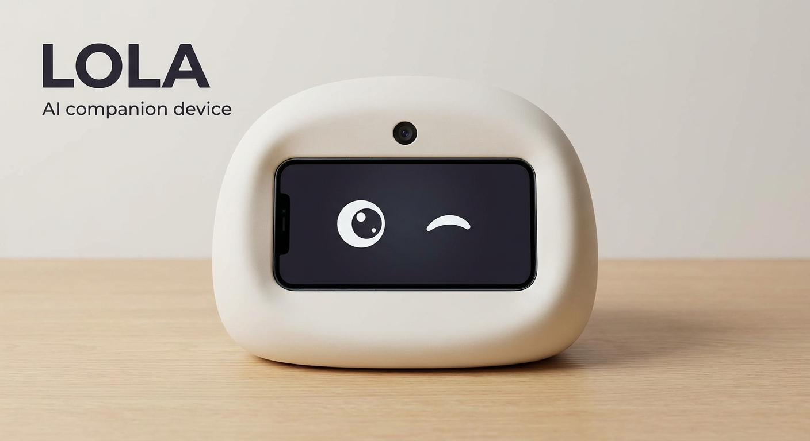
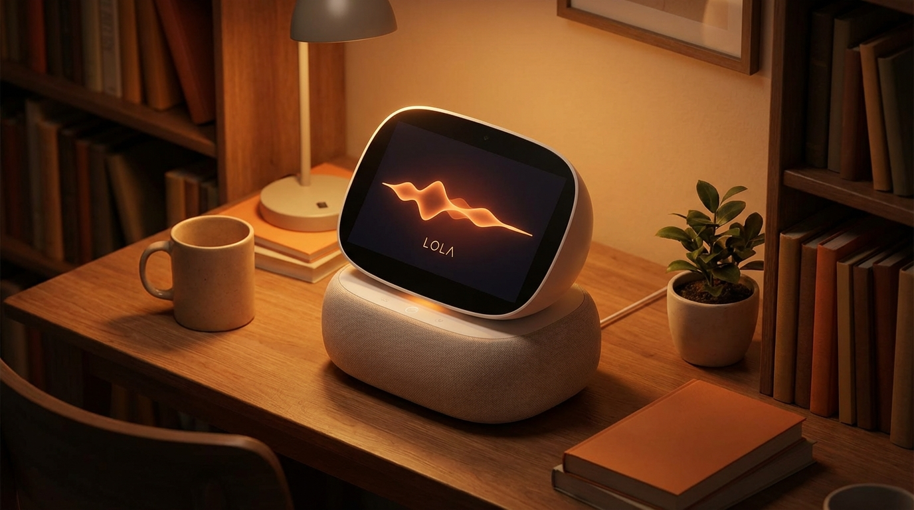
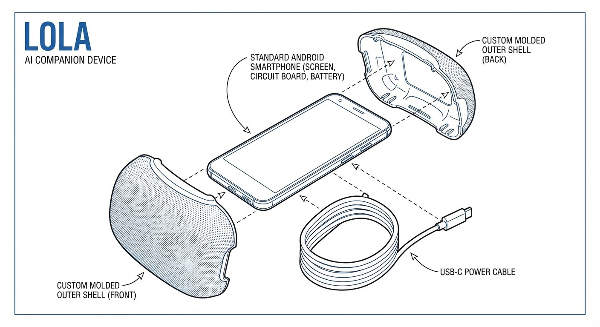

# LOLA - AI Companion Device



**LOLA (Learning-Oriented Life Assistant)** is a friendly, always-on AI companion designed to be a presence in your daily life. Unlike traditional assistants that wait for commands, LOLA is designed to be a conversational partner, a practice companion, and a digital friend.

## 🌟 Features

- **🗣️ Voice Interaction**: Talk to LOLA naturally using the Push-to-Talk interface. She listens and responds with a friendly voice.
- **👁️ Vision Capabilities**: LOLA can "see" the world through the camera. Just ask her to "take a look," and she will describe what she sees.
- **😊 Expressive Avatar**: An anime-style digital face that reacts to conversation states (Listening, Thinking, Speaking) with animations.
- **🛡️ Safety First**: Built-in safety layers to filter unsafe topics and a "Safe Mode" toggle.
- **📱 PWA Kiosk Mode**: Designed to run as a full-screen app on Android devices, turning an old phone into a dedicated AI device.
- **🧠 Mock Brain (MVP)**: Currently running on a simulated intelligence for testing. Ready to be connected to Gemini/OpenAI APIs.

## 📸 Hardware Design Gallery

|               Front View               |                 Isometric View                 |                Exploded View                 |
| :------------------------------------: | :--------------------------------------------: | :------------------------------------------: |
|  |  |  |

## 🚀 Getting Started

### Prerequisites

- Node.js 18+ installed.
- An Android phone (optional, for the full device experience).

### Installation

1.  **Clone the repository**:

    ```bash
    git clone https://github.com/prashant13-bh/LOLA.AI.git
    cd LOLA.AI
    ```

2.  **Install dependencies**:

    ```bash
    npm install
    ```

3.  **Run the development server**:

    ```bash
    npm run dev
    ```

4.  **Open in Browser**:
    Visit `http://localhost:3000` to see LOLA in action.

### Turning your Phone into the Device

1.  Connect your phone to the same Wi-Fi network as your computer.
2.  Find your computer's Local IP Address (e.g., `192.168.1.X`).
3.  On your phone, open Chrome and visit `http://YOUR_LOCAL_IP:3000`.
4.  Tap the **Three Dots Menu** -> **Add to Home Screen**.
5.  Launch the app from your home screen to enter **Kiosk Mode**.

## ⚙️ Configuration

- **Safe Mode**: Toggle in the Settings menu (Gear icon) to enable/disable content filtering.
- **Clear Memory**: Use the Settings menu to wipe the local conversation history.
- **Real AI**: To connect a real LLM, edit `src/lib/llm.ts` and replace the mock logic with your API call.

## 🛠️ Tech Stack

- **Framework**: Next.js 14 (App Router)
- **Styling**: TailwindCSS
- **Language**: TypeScript
- **APIs**: Web Speech API (STT/TTS), MediaDevices (Camera), Wake Lock API.

## 📝 License

This project is licensed under the MIT License.
